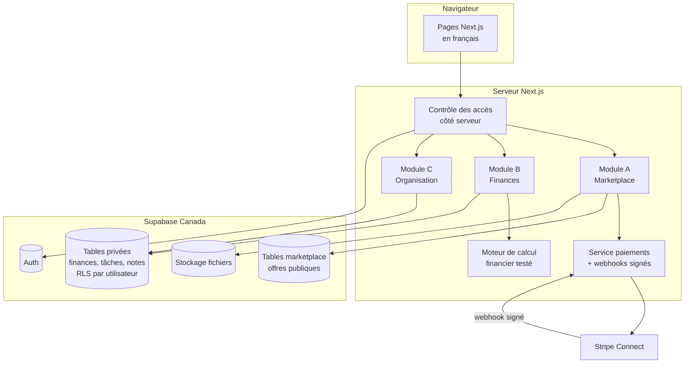

# Plan de phase 0 — Plateforme « Marketance »

> Nom : **Marketance** (choisi par Madd le 21 octobre 2026).
> Rédigé le 20 octobre 2026. Les prix viennent de recherches faites ce jour-là et doivent être revérifiés sur le site officiel de chaque service au moment de payer.

---

## 1. Résumé du projet

Une application web en français, pensée pour le Québec et le Canada (CAD, fuseau America/Toronto), qui réunit trois espaces sous un même compte :

| Module | Ce que ça fait | Qui voit les données |
|---|---|---|
| **A. Marketplace** | Découvrir, proposer, réserver ou louer des services et des applications numériques | Public pour les offres publiées, privé pour les commandes |
| **B. Finances personnelles** | Revenus, dépenses, budgets, comptes, dettes, actifs, passifs, patrimoine net | **Uniquement l'utilisateur**. Jamais les vendeurs, clients ou administrateurs dans l'interface |
| **C. Organisation** | Calendrier, tâches, rappels, notes, objectifs | Uniquement l'utilisateur |

**Ce qui compte vraiment :** livrer un MVP utilisable, sans dépenses inutiles, puis grandir par petites étapes testées.

### Une recommandation importante (à lire)

La marketplace est de loin le module le plus risqué : il faut deux publics (vendeurs et clients), des paiements, des règles fiscales (TPS/TVQ des plateformes) et des litiges. Les modules B et C, eux, servent **un seul utilisateur à la fois** et peuvent être utiles dès le premier jour, même pour toi seul.

**Je recommande donc d'inverser les phases 3 et 4 :** construire d'abord le MVP financier (+ tâches), l'utiliser toi-même pendant quelques semaines, puis attaquer la marketplace avec un socle (comptes, sécurité, tests, déploiement) déjà rodé. Tu apprends le métier sur le module le moins risqué. Le plan ci-dessous suit cet ordre, et l'ordre d'origine reste possible si tu préfères.

---

## 2. Architecture recommandée

### Choix retenu (une seule architecture, gardée tout le projet)

| Couche | Outil | Pourquoi c'est le bon choix pour toi |
|---|---|---|
| Application | **Next.js (App Router) + React + TypeScript strict** | Un seul projet pour les pages ET le code serveur. Énorme documentation, l'IA le connaît très bien. |
| Styles | **Tailwind CSS** | Pas de fichiers CSS à organiser, styles cohérents. |
| Base de données | **PostgreSQL via Supabase** | Vraie base relationnelle (indispensable pour l'argent), RLS pour isoler les données par utilisateur, interface web simple. |
| Comptes | **Supabase Auth** | Inscription, vérification courriel, mot de passe oublié déjà faits et sécurisés. |
| Fichiers | **Supabase Storage** | Images d'annonces, pièces justificatives, avec règles d'accès. |
| Validation | **Zod** | Mêmes règles côté formulaire et côté serveur. |
| Graphiques | **Recharts** | Simple, React, suffisant pour des tableaux de bord. |
| Composants accessibles | **Radix UI** (via shadcn/ui) | Menus, fenêtres, onglets accessibles au clavier sans tout coder. |
| Tests | **Vitest** (unitaires) + **Playwright** (bout en bout) | Gratuits, rapides, standards. |
| Code | **Git + GitHub** | Historique, retour en arrière, déploiement automatique. |
| Hébergement | **Vercel** | Déploiement en un clic depuis GitHub, HTTPS automatique. |
| Paiements (plus tard) | **Stripe Connect** en mode test d'abord | Gère les versements aux fournisseurs, la conformité et les cartes. **Nous ne stockons jamais de carte.** |
| Erreurs en production | **Sentry** (forfait gratuit) | Savoir quand ça casse avant les utilisateurs. |
| Courriels | **Resend** (forfait gratuit) | Courriels de vérification et notifications. |

**Ce que nous n'utilisons pas :** microservices, Kubernetes, serveurs à gérer soi-même, plusieurs bases de données. Inutile à cette taille.

**Point d'attention hébergement :** le forfait gratuit Vercel Hobby est réservé à un usage **non commercial**. Il convient pour développer et pour un pilote gratuit. Dès que la plateforme encaisse de l'argent, il faut passer à Vercel Pro (environ 20 $ US/mois, soit environ 28 $ CA) ou migrer vers une alternative (Cloudflare, Netlify). C'est prévu au budget.

**Région des données :** créer le projet Supabase dans la région **Canada (Central)** pour garder les données au Canada, ce qui simplifie les obligations de la Loi 25.

### Prototype statique (phase 1)

Le prototype livré avec ce plan est un **fichier HTML unique**, sans serveur ni base de données. Il sert à valider l'apparence et les parcours. Il **ne peut pas** gérer de vrais comptes, garder des données ou encaisser des paiements : tout ce qui y est saisi disparaît au rechargement. Ces fonctions arrivent avec Next.js et Supabase en phase 2.

---

## 3. Diagramme des modules



**Règle d'or :** le module A n'a **aucun** accès en lecture aux tables du module B. Les deux partagent seulement la table `profiles`. Les politiques RLS l'imposent dans la base, pas seulement dans le code.

---

## 4. Fonctionnalités du MVP et fonctions reportées

### MVP (ce qui sera livré et testé)

**Socle commun**
- Inscription, connexion, déconnexion, vérification courriel, mot de passe oublié.
- Profil (nom affiché, fuseau horaire, préférences).
- Rôles : client, fournisseur, administrateur (un compte peut cumuler client + fournisseur).
- Pages légales : conditions, confidentialité, annulation/remboursement (à faire relire, voir risques).
- Pages d'erreur 404 et 500 en français.

**Module B — Finances**
- Comptes manuels (courant, épargne, comptant, crédit, prêt, placement).
- Opérations : revenu, dépense, transfert, avec statut prévu / réalisé / annulé.
- Catégories par défaut + catégories personnelles.
- Budget mensuel par catégorie avec pourcentage consommé.
- Actifs et passifs avec date et source d'estimation.
- Patrimoine net = actifs − passifs.
- Tableau de bord du mois + comparaison avec le mois précédent.
- Export CSV de ses propres données.
- Moteur de calcul en cents, couvert par des tests unitaires.

**Module C — Organisation**
- Tâches (priorité, échéance, terminée, en retard).
- Événements de calendrier (vue mois + liste), sans récurrence au début.
- Notes avec étiquettes, épinglage et recherche simple.

**Module A — Marketplace**
- Catalogue public, recherche, filtres par catégorie.
- Fiche d'offre.
- Fournisseur : créer, modifier, dépublier ses propres offres.
- Demande de réservation avec cycle de statuts (sans paiement réel).
- Administration minimale : catégories, modération des offres, signalements.

### Reporté (après le MVP)
- Paiements réels, commissions, versements, remboursements Stripe (mode test d'abord).
- Abonnements récurrents et accès numériques automatisés (licences, révocation).
- Avis et évaluations.
- Événements récurrents et modifications d'occurrences.
- Dettes avancées : projections avalanche / boule de neige.
- Objectifs d'épargne avec projections.
- Import CSV bancaire avec détection des doublons.
- Notifications par courriel et rappels programmés.
- Widgets de tableau de bord réorganisables.
- Thème sombre complet, internationalisation (anglais).

---

## 5. Première arborescence (application réelle, phase 2)

```
marketance/
├─ README.md  ARCHITECTURE.md  ROADMAP.md  SECURITY.md
├─ TESTING.md  DEPLOYMENT.md  CHANGELOG.md  .env.example
├─ docs/
│  ├─ modele-donnees.md
│  ├─ calculs-financiers.md
│  └─ sauvegarde-restauration.md
├─ supabase/
│  ├─ migrations/            # fichiers SQL numérotés, jamais modifiés après application
│  └─ tests/                 # tests des politiques RLS
├─ src/
│  ├─ app/                   # pages (App Router)
│  │  ├─ (public)/           # accueil, catalogue, offre/[slug], faq, contact, legal/…
│  │  ├─ (auth)/             # connexion, inscription, mot-de-passe
│  │  ├─ (espace)/           # finances/, organisation/, fournisseur/, compte/
│  │  ├─ admin/
│  │  ├─ api/webhooks/stripe/
│  │  ├─ not-found.tsx  error.tsx
│  ├─ components/ui/         # boutons, champs, cartes réutilisables
│  ├─ features/
│  │  ├─ marketplace/        # composants + actions serveur du module A
│  │  ├─ finance/            # module B
│  │  └─ organizer/          # module C
│  ├─ lib/
│  │  ├─ money/              # cents, formatage CAD, arrondis
│  │  ├─ finance-engine/     # calculs purs et testés
│  │  ├─ dates/              # fuseaux, échéances
│  │  ├─ supabase/           # clients serveur et navigateur
│  │  ├─ auth/               # session, rôles, garde-fous
│  │  └─ validation/         # schémas Zod
│  └─ types/
└─ tests/
   ├─ unit/
   └─ e2e/
```

---

## 6. Modèle de données initial

Conventions : identifiants `uuid`, montants en **cents entiers** (`bigint`), devise `char(3)` par défaut `'CAD'`, dates en `timestamptz` (stockées en UTC, affichées en America/Toronto), colonnes `created_at` / `updated_at` partout. Chaque table privée a `user_id` et une politique RLS `user_id = auth.uid()` pour lecture, insertion, modification, suppression.

### Phase 2 — socle
| Table | Colonnes clés | Règles |
|---|---|---|
| `profiles` | `id` (= `auth.users.id`), `display_name`, `timezone` défaut `America/Toronto`, `locale` | Lecture publique limitée au nom affiché des fournisseurs |
| `user_roles` | `user_id`, `role` (`client`, `provider`, `admin`) | Clé primaire (`user_id`, `role`). Modifiable par admin seulement |

### Phase 3 — finances (module B)
| Table | Colonnes clés | Règles |
|---|---|---|
| `fin_accounts` | `user_id`, `name`, `kind` (checking, savings, cash, credit_card, loan, investment, other), `opening_balance_cents`, `is_liability`, `archived_at` | RLS propriétaire |
| `fin_categories` | `user_id` (null = catégorie par défaut), `name`, `direction` (income/expense), `is_active` | Les défauts sont en lecture seule |
| `fin_transactions` | `user_id`, `account_id`, `kind` (income, expense, transfer), `amount_cents` > 0, `occurred_on` date, `status` (planned, completed, cancelled), `category_id`, `transfer_account_id`, `notes`, `dedupe_key` | `CHECK amount_cents > 0`. Un transfert exige `transfer_account_id` ≠ `account_id` et n'a pas de catégorie. Index unique (`user_id`, `dedupe_key`) contre les doublons |
| `fin_budgets` | `user_id`, `category_id`, `period_start`, `period_end`, `amount_cents`, `alert_percent` | Unique par catégorie et période |
| `fin_assets` | `user_id`, `name`, `kind`, `value_cents`, `valued_on`, `valuation_source` | Une estimation n'est jamais présentée comme officielle |
| `fin_liabilities` | `user_id`, `name`, `creditor`, `balance_cents`, `annual_rate_bp` (points de base), `min_payment_cents`, `payment_frequency`, `next_due_on`, `account_id` | Lien optionnel vers un compte de type crédit/prêt pour éviter le double comptage |

### Phase 4 — organisation (module C)
| Table | Colonnes clés |
|---|---|
| `tasks` | `user_id`, `title`, `priority` (1–3), `due_at`, `completed_at`, `project`, `parent_task_id` |
| `events` | `user_id`, `title`, `starts_at`, `ends_at`, `category`, `notes` |
| `notes` | `user_id`, `title`, `body`, `tags text[]`, `pinned`, `archived_at`, `search tsvector` (recherche plein texte en français) |

### Phase 5 — marketplace (module A)
| Table | Colonnes clés | Règles |
|---|---|---|
| `mk_categories` | `slug`, `name`, `parent_id`, `position`, `is_active` | Écriture admin |
| `mk_listings` | `provider_id`, `category_id`, `type` (service, digital_app), `title`, `description`, `price_cents`, `currency`, `billing_unit` (fixed, hour, day, month), `access_duration_days`, `cancellation_policy`, `status` (draft, published, suspended, archived) | Lecture publique **seulement si** `status = 'published'`. Écriture par le propriétaire uniquement |
| `mk_listing_images` | `listing_id`, `storage_path`, `position`, `alt_text` | |
| `mk_bookings` | `listing_id`, `client_id`, `provider_id`, `status`, `requested_start`, `price_cents_snapshot`, `status_changed_at` | Visible du client et du fournisseur concernés seulement. Transitions contrôlées par une fonction serveur |
| `mk_reports` | `reporter_id`, `listing_id`, `reason`, `status` | |
| `audit_log` | `actor_id`, `action`, `entity`, `entity_id`, `at` | Jamais de montant financier personnel ni de secret |

**Cycle de vie d'une réservation :**
`draft → requested → accepted | declined → (payment_pending → paid) → confirmed → in_progress → completed`, avec `cancelled`, `expired`, `payment_failed`, `refunded`, `disputed`. Le statut « payé » ne viendra **que** d'un webhook Stripe signé, jamais du retour du client sur une page.

Les tables de paiements (`payments`, `refunds`, `payouts`), d'abonnements et d'accès numériques arrivent en phase 8, une fois Stripe validé.

### Définitions des indicateurs financiers (version 1)
- **Revenus du mois** : somme des opérations `income` au statut `completed` dont la date tombe dans le mois (fuseau de l'utilisateur).
- **Dépenses du mois** : idem pour `expense`. Les transferts ne comptent **ni** comme revenu **ni** comme dépense (un paiement de carte de crédit est un transfert).
- **Solde net du mois** : revenus − dépenses.
- **Prévu** : même calcul avec le statut `planned`, affiché séparément.
- **Solde calculé d'un compte** : solde d'ouverture + entrées réalisées − sorties réalisées (transferts inclus).
- **Patrimoine net** : total des actifs − total des passifs.
- Les opérations `cancelled` sont exclues de tous les totaux.

---

## 7. Risques

### Techniques
| Risque | Gravité | Parade |
|---|---|---|
| Fuite de données financières entre utilisateurs | Très élevée | RLS sur chaque table privée + tests automatisés « l'utilisateur A ne voit pas les données de B » avant chaque mise en ligne |
| Erreurs d'arrondi dans les montants | Élevée | Cents entiers partout, un seul module de calcul, tests unitaires |
| Clé secrète Supabase ou Stripe exposée dans le navigateur | Très élevée | Clés secrètes uniquement côté serveur, `.env` jamais versionné, analyse des secrets sur GitHub |
| Code généré par IA accepté sans comprendre | Moyenne | Petites étapes, tests à chaque bloc, explications dans chaque livraison |
| Projet Supabase gratuit mis en pause après 7 jours d'inactivité | Faible en dev | Normal en développement ; passer au forfait Pro avant les vrais utilisateurs |
| Dates décalées (fuseaux, heure d'été) | Moyenne | Stockage UTC, calculs de mois dans le fuseau de l'utilisateur, tests autour de mars et novembre |

### Financiers
| Risque | Parade |
|---|---|
| Coûts qui montent avec l'usage (hébergement, base, courriels) | Plafond de dépenses activé sur Supabase, alertes de facturation, revue mensuelle |
| Frais Stripe sous-estimés | Intégrer 2,9 % + 0,30 $ par paiement par carte canadienne et les frais Connect dans le prix des offres |
| Taux de change (services facturés en dollars US) | Budget calculé à 1,40 $ CA pour 1 $ US, avec marge |

### Confidentialité et légal (Québec)
Ce plan **identifie** les obligations ; il ne remplace pas un avis juridique ou comptable.
- **Loi 25 (protection des renseignements personnels)** : désigner un responsable de la protection des renseignements personnels (par défaut, toi), publier une politique de confidentialité claire, tenir un registre des incidents, obtenir un consentement explicite, et faire une **évaluation des facteurs relatifs à la vie privée** avant de transférer des données hors Québec (d'où la région Canada pour Supabase, à documenter quand même).
- **Données financières** : jamais dans les pages publiques, les journaux, les exports d'autres utilisateurs ni les outils d'analyse. Pas de connexion bancaire par identifiants.
- **Loi sur la protection du consommateur** : règles des contrats à distance (informations avant achat, confirmation écrite, droits d'annulation).
- **Taxes** : la TPS/TVH et la TVQ prévoient des règles propres aux **exploitants de plateformes de distribution numériques** qui peuvent devoir percevoir les taxes à la place des fournisseurs. À valider avec un comptable avant la phase 8.
- **Garde des fonds** : ne jamais encaisser puis reverser soi-même. Stripe Connect s'en charge ; sinon, risque d'être considéré comme une entreprise de services monétaires.
- **Loi canadienne anti-pourriel** : consentement avant tout courriel promotionnel.
- **Langue française (Loi 96)** : interface et contrats en français, c'est déjà prévu.
- **Revente d'abonnements tiers** : interdite sans autorisation écrite du titulaire des droits.

---

## 8. Calendrier réaliste

Hypothèse : **environ 8 heures par semaine**, avec l'IA qui écrit la majorité du code. À ajuster selon ton temps réel.

| Semaines | Phase | Résultat vérifiable |
|---|---|---|
| 1 | 0 + 1 Plan et prototype | Ce document + prototype cliquable (livré aujourd'hui) |
| 2–3 | 2 Socle technique | Dépôt GitHub, Next.js en ligne sur une adresse Vercel, connexion qui fonctionne |
| 4–7 | 3 MVP financier | Tu saisis tes vraies opérations, les totaux sont testés |
| 8–9 | 4 Organisation | Tâches, calendrier, notes |
| 10–14 | 5 MVP marketplace | Offres publiées, recherche, demandes de réservation, admin minimale |
| 15–16 | 6 Qualité et sécurité | Tests RLS, accessibilité, sauvegarde restaurée une fois pour de vrai |
| 17–18 | 7 Publication pilote | Domaine, pages légales relues, 5 à 10 testeurs invités |
| 19+ | 8 Évolution | Stripe en mode test, puis paiements réels après validation |

Soit environ **4 à 5 mois** jusqu'à un pilote. Viser plus vite est possible, mais au prix des tests, et ce sont eux qui protègent les données.

---

## 9. Budget détaillé (dollars canadiens)

Taux utilisé : 1 $ US ≈ 1,40 $ CA. Prix relevés le 20 octobre 2026 sur des sources publiques ; à revérifier sur les pages officielles avant tout achat.

| Service | Utilité | Coût de départ | Coût récurrent | Limites du gratuit | Frais variables | Remplacement possible |
|---|---|---|---|---|---|---|
| GitHub | Code et versions | 0 $ | 0 $ | Dépôts privés illimités | Non | GitLab |
| Vercel Hobby → Pro | Hébergement | 0 $ | Pro ≈ 28 $/mois | Hobby : usage **non commercial** seulement | Dépassements d'usage sur Pro | Cloudflare, Netlify |
| Supabase Free → Pro | Base, comptes, fichiers | 0 $ | Pro ≈ 35 $/mois | 2 projets, 500 Mo de base, pause après 7 jours sans activité | Stockage et trafic au-delà du forfait (plafond activable) | Neon + Auth.js |
| Nom de domaine `.ca` | Adresse du site | ≈ 20 $/an | ≈ 20 $/an | — | Non | `.com` similaire |
| Resend | Courriels | 0 $ | 0 $ au début | ≈ 3 000 courriels/mois | Forfait payant au-delà | Postmark, Brevo |
| Sentry | Suivi des erreurs | 0 $ | 0 $ | 5 000 erreurs/mois environ | Forfait payant au-delà | Logs Vercel |
| Stripe (phase 8) | Paiements | 0 $ | 0 $ fixe | Mode test gratuit | ≈ 2,9 % + 0,30 $ par carte canadienne ; Connect ≈ 2 $ US par fournisseur actif/mois + frais de versement | Square, PayPal |
| Relecture juridique / comptable | Pages légales, taxes | — | Ponctuel | — | — | Modèles du gouvernement + Éducaloi (ne suffisent pas seuls) |

Les outils d'IA que tu utilises déjà ne sont pas comptés ici.

### Trois scénarios sur 12 mois

| Scénario | Ce qu'il contient | Total estimé |
|---|---|---|
| **Minimal** | Tout en gratuit, pilote non commercial, domaine | **≈ 20 $** |
| **Recommandé** | Gratuit pendant 6 mois de développement, puis Vercel Pro + Supabase Pro pendant 6 mois de pilote commercial, domaine, réserve de 150 $ | **≈ 550 $** |
| **Croissance** | Pro sur les deux services pendant 12 mois, domaine, 250 $ de relecture juridique ou comptable | **≈ 1 020 $** (dépasse légèrement le plafond : nécessiterait ton accord) |

Aucune dépense n'est faite sans ton accord explicite.

---

## 10. Plan d'exécution ordonné

1. ✅ **Phase 0** — ce plan.
2. ✅ **Phase 1 (premier livrable)** — prototype cliquable : accueil, catalogue avec recherche et filtres, fiche d'offre, tableau de bord financier calculé à partir des opérations, tâches. Données fictives clairement indiquées.
3. **Décisions** : ordre des modules ✅ finances d'abord (choisi par Madd le 20 octobre 2026) ; création du dépôt GitHub en attente.
4. **Phase 2** — créer le dépôt, initialiser Next.js + TypeScript strict + Tailwind + ESLint + Vitest + Playwright, premier déploiement Vercel (gratuit), projet Supabase gratuit en région Canada, connexion par courriel, première migration (`profiles`, `user_roles`) avec tests RLS.
5. **Phase 3** — moteur de calcul financier en premier (tests d'abord), puis tables et écrans du module B.
6. **Phase 4** — organisation.
7. **Phase 5** — marketplace.
8. **Phase 6** — revue sécurité, tests de confidentialité, sauvegarde et restauration réelles.
9. **Phase 7** — pages légales relues, domaine, pilote.
10. **Phase 8** — Stripe en mode test, puis paiements réels après validation.

Chaque phase se termine par : tests exécutés, résultats notés, documentation à jour, et ton feu vert avant la suivante.
